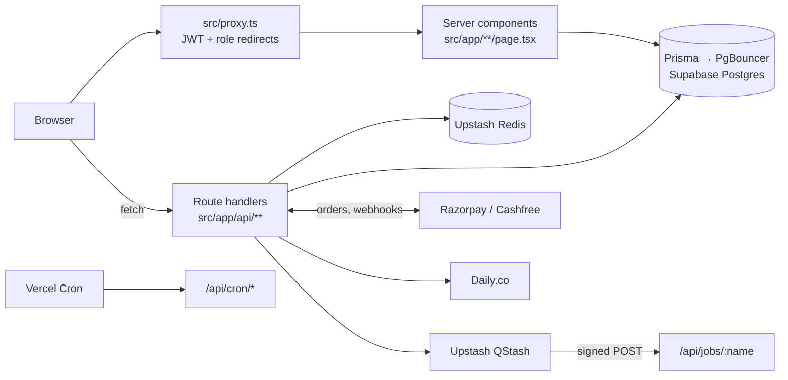

# Divergent LMS

A learning platform where students buy courses or bundles, watch lessons, take timed exams, join live classes and ask teachers their doubts. Teachers run classes, grade written answers and track their students. Admins manage courses, coupons, approvals and revenue.

It is one Next.js app deployed on Vercel, with PostgreSQL (Supabase) through Prisma, Upstash Redis and QStash, Razorpay and Cashfree for payments, and Daily.co for live video.

## Features

| Role | What they can do |
| --- | --- |
| **Student** | Buy courses and bundles (coupons, EMI plans), watch lessons and track progress, take exams with negative and partial marking, join live classes, ask doubts, chat in the community, earn XP and certificates, set weekly study goals |
| **Teacher** (`MENTOR`) | Schedule and run live classes, build tests and grade sketch answers, review assignments, answer doubts, see analytics for the courses they teach |
| **Admin** | Manage courses, chapters, lessons, exams, cohorts, students, installments and moderation |
| **Super admin** | Everything an admin can, plus admins, approvals, coupons, revenue, announcements, audit logs and institute settings |

## Tech stack

| Layer | Choice |
| --- | --- |
| Framework | Next.js 16 (App Router), React 19, TypeScript, Tailwind CSS 4 |
| Database | PostgreSQL on Supabase, Prisma 6 (PgBouncer transaction pooler for serverless) |
| Auth | JWT (`jose`, HS256) in an httpOnly cookie, bcrypt, Google OAuth, phone OTP over WhatsApp |
| Redis | Upstash: rate limits, session revocation, signup Bloom filters |
| Background jobs | Upstash QStash (retried batches) and Vercel Cron |
| Payments | Razorpay and Cashfree, with webhooks and nightly reconciliation |
| Live video | Daily.co rooms, behind a circuit breaker |
| Messaging | Interakt (WhatsApp OTPs and class reminders), Nodemailer (email) |
| Monitoring | Sentry, Vercel Speed Insights |
| Tests | Vitest, Playwright, k6 |

## How it fits together



- **Pages** are protected by `src/proxy.ts` (Next 16's name for middleware), which redirects by role. Every API route checks auth again with `requireAuth` or `withApiHandler`.
- **Course access** lives in `src/lib/course-access.ts`: admins manage every course, teachers only the courses they teach, and students only see content for courses they are enrolled in.
- **Payments** reach their outcome through the browser's verify call, the gateway webhook or the reconciliation cron. All three call `completePayment` in `src/lib/payments.ts`, which marks the payment paid and enrolls the student exactly once.
- **Exams** start and submit through `src/app/api/courses/[courseId]/tests/[testId]/{start,submit}`. The attempt limit and XP are decided in one locked transaction, and grading lives in `src/lib/test-grading.ts`.

## Getting started

You need Node.js 20 or newer and a PostgreSQL database for development. Use a Supabase project of your own or a local Postgres. **Never point a development `.env` at production.**

```bash
git clone https://github.com/Webnexis252/divergent.git
cd divergent
npm install            # also runs `prisma generate`
cp .env.example .env   # then fill in the values below
npx prisma migrate deploy
npm run dev
```

Open http://localhost:3000. To create a super admin, run `node scripts/seed-superadmin.js <email> <password> [name]`, or promote an existing account with `node scripts/make-admin.mjs <email>`. The database seed and the load-test seeding refuse to touch a non-local database unless `CONFIRM_DATABASE` names it (see `scripts/lib/db-guard.mjs`).

### Environment variables

`.env.example` lists every variable with notes. The minimum to run locally:

| Variable | Purpose |
| --- | --- |
| `DATABASE_URL` | Pooled connection used by the app |
| `DIRECT_URL` | Direct connection used by migrations |
| `JWT_SECRET` | Signs sign-in tokens; use a long random value |
| `NEXT_PUBLIC_APP_URL` | The app's own URL, no trailing slash |

Optional features turn on when their variables are set:

| Feature | Variables |
| --- | --- |
| File storage | `NEXT_PUBLIC_SUPABASE_URL`, `NEXT_PUBLIC_SUPABASE_ANON_KEY`, `SUPABASE_SERVICE_ROLE_KEY` |
| Payments | `RAZORPAY_KEY_ID`, `RAZORPAY_KEY_SECRET`, `RAZORPAY_WEBHOOK_SECRET`, `CASHFREE_APP_ID`, `CASHFREE_SECRET_KEY`, `CASHFREE_ENVIRONMENT` |
| Google sign-in | `GOOGLE_CLIENT_ID`, `GOOGLE_CLIENT_SECRET` |
| Live classes | `DAILY_API_KEY` |
| Rate limits, sessions | `UPSTASH_REDIS_REST_URL`, `UPSTASH_REDIS_REST_TOKEN` (required in production) |
| Background jobs | `APP_URL`, `QSTASH_TOKEN`, `QSTASH_CURRENT_SIGNING_KEY`, `QSTASH_NEXT_SIGNING_KEY` |
| WhatsApp | `INTERAKT_API_KEY`, `INTERAKT_OTP_TEMPLATE_NAME`, `INTERAKT_CLASS_REMINDER_TEMPLATE_NAME` |
| Email | `EMAIL_HOST`, `EMAIL_PORT`, `EMAIL_USER`, `EMAIL_PASS`, `EMAIL_FROM`, `WEEKLY_REPORTS_ENABLED` |
| Cron routes | `CRON_SECRET` |
| Error tracking | `SENTRY_DSN`, `NEXT_PUBLIC_SENTRY_DSN` and the trace sample rates |

## Scripts

| Command | What it does |
| --- | --- |
| `npm run dev` | Start the dev server |
| `npm run build` / `npm start` | Production build and server |
| `npm run lint` | ESLint |
| `npm run type-check` | TypeScript, no output |
| `npm test` | Unit tests (Vitest) |
| `npm run test:integration` | Tests against a real, disposable Postgres (`TEST_DATABASE_URL`) |
| `npm run test:e2e` | Playwright browser tests |

## Deployment

The app runs on Vercel in the Singapore region (`sin1`), next to the database. `vercel.json` schedules three cron jobs: the Bloom filter rebuild, payment reconciliation and the weekly progress emails. For AWS (Amplify Hosting or a Docker container, plus EventBridge schedules for the crons) see [`docs/deploy-aws.md`](docs/deploy-aws.md). [`docs/operations.md`](docs/operations.md) has the launch checklist and explains how to switch on each feature, run migrations, set up the Razorpay webhook, QStash, WhatsApp reminders, Sentry and the exam-day load test.

## Project structure

```
src/
  app/
    (public)/        Public course and bundle pages
    admin/           Admin and super admin areas
    dashboard/       Student area; dashboard/teacher is the teacher area
    api/             Route handlers (auth, payments, courses, tests, live classes, cron, jobs…)
  components/        Shared UI
  hooks/             Client hooks, e.g. use-polling
  lib/               Server logic: auth, payments, coupons, course access, jobs, analytics…
  test/              Unit and integration tests
prisma/              Schema, migrations, seeds
scripts/             Admin, seeding and verification scripts
e2e/                 Playwright tests
loadtests/           k6 exam-day load test
docs/                Operations guide and plans
```
